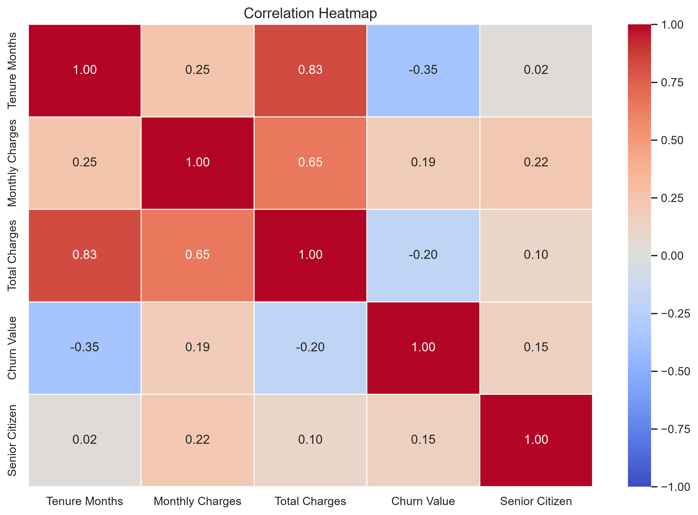

hi, i am Adil.
I made this README.md file for one of my previous projects with the help of an AI agent.
It gives great overview but some dataset conclusions, exploration results, correlation matrices etc. currently missing. (.png files mostly) including (Exact missing files on README.md: 1-Churn Rate by Contract Type, 2- Churn Rate by Tenure Group, 3- Churn Rate by Internet Service, 4- Correlation Heatmap, 5- Model Performance Comparison, 6- Precision-Recall Curve Comparison, 7- Confusion Matrix - Final Random Forest, 8- ROC Curve - Final Random Forest, 9- Precision-Recall Curve - Final Random Forest, 10- Threshold Analysis - Final Random Forest, 11- Data Leakage Experiment - Model Comparison) which I would be happy to add these visualizations if you find the project and its analysis worth reviewing. The relevant project files and notebooks are also available in the repository, so the figures can be generated directly from the existing analysis.

Thank you for your time and feedback.

Best regards,
Adil


# Customer Churn Prediction

## Project Overview

This project focuses on predicting customer churn using machine learning techniques on the Telco Customer Churn dataset.

Customer churn is a major challenge for telecommunications companies, as losing existing customers can negatively affect revenue and long-term business growth.

The main objective of this project is to identify customers who are likely to leave the company and explore customer characteristics associated with churn.

The project follows an end-to-end machine learning workflow, including exploratory data analysis, data preprocessing, feature engineering, model development, evaluation, and data leakage investigation.

## Project Objectives

- Explore customer characteristics and identify patterns associated with churn.
- Perform exploratory data analysis (EDA) to understand customer behavior.
- Prepare numerical and categorical features for machine learning.
- Develop and compare different classification algorithms.
- Optimize the classification threshold using a validation dataset.
- Evaluate the final model on an unseen test dataset.
- Investigate potential data leakage caused by suspicious features.

## Dataset

This project uses the **Telco Customer Churn IBM Dataset**, which contains customer information and features related to churn behavior in a telecommunications company.

- **Source:** [Telco Customer Churn - IBM Dataset (Kaggle)](https://www.kaggle.com/datasets/yeanzc/telco-customer-churn-ibm-dataset)
- **Format:** CSV
- **Target Variable:** `Churn`

The dataset is publicly available on Kaggle. Please download the dataset from the link above and place it in the appropriate data directory before running the project.

The dataset includes information such as:

- Customer demographics
- Internet and phone services
- Contract types
- Payment methods
- Customer tenure
- Monthly and total charges
- Customer churn status

The target variable is Churn Value:

- `0`: Customer did not churn.
- `1`: Customer churned.

The original dataset is stored in the `data/raw/` directory and is not included in this repository.

## Project Structure

```text
customer-churn-prediction/
│
├── data/
│   └── raw/
│       └── Telco_customer_churn.xlsx
│
├── notebooks/
│   ├── 01_data_quality_check.ipynb
│   ├── 02_exploratory_data_analysis.ipynb
│   ├── 03_data_preprocessing.ipynb
│   ├── 04_model_training.ipynb
│   ├── 05_model_evaluation.ipynb
│   └── 06_data_leakage_experiment.ipynb
│
├── models/
│   └── final_random_forest.pkl
│
├── reports/
│   └── figures/
│
├── README.md
└── requirements.txt
```

**Note:** The notebook filenames above represent the recommended naming convention. Adjust them to match the actual filenames in your repository.

## Project Workflow

### 1. Data Quality Assessment

The initial dataset was examined to understand its structure and identify potential data quality issues.

**Main activities:**

- Dataset inspection and statistical summaries.
- Numerical and categorical feature identification.
- Missing value analysis.
- Data type inspection.
- Identification of potential data quality issues.

### 2. Exploratory Data Analysis (EDA)

Exploratory Data Analysis was performed to identify patterns and relationships between customer characteristics and churn behavior.

**The analysis included:**

- Univariate analysis.
- Bivariate analysis.
- Missing value analysis.
- Outlier detection using the IQR method.
- Correlation analysis.
- Customer segmentation and churn analysis.

**Important findings:**

- Month-to-month customers had the highest churn rate at 42.71%.
- Electronic check users had the highest churn rate at 45.29%.
- Fiber optic customers had a churn rate of 41.89%.
- Customers with 0–12 months of tenure had the highest churn rate at 47.44%.
- Churn rates generally decreased as customer tenure increased.

**Business Insight:** New customers, month-to-month contract customers, and certain service segments represent important groups for potential retention strategies.

#### Recommended Visualizations

**CHURN RATE BY CONTRACT TYPE**


**CHURN RATE BY TENURE GROUP**


**CHURN RATE BY INTERNET SERVICE**


**CORRELATION HEATMAP**



### 3. Data Preprocessing and Feature Engineering

The preprocessing stage prepared the dataset for machine learning.

**Main steps:**

- Defined Churn Value as the target variable.
- Removed customer identifiers and duplicate target information.
- Excluded post-churn information.
- Excluded Churn Score and CLTV from the baseline model due to uncertain prediction-time availability.
- Converted Total Charges into a numerical feature.
- Identified numerical and categorical variables.
- Applied a stratified 80/20 train-test split.

**Preprocessing techniques:**

| Feature Type | Technique |
|---|---|
| Numerical | Median Imputation |
| Numerical | Standard Scaling |
| Categorical | Most Frequent Imputation |
| Categorical | One-Hot Encoding |

A ColumnTransformer and Scikit-learn Pipeline were used to ensure consistent preprocessing.

All preprocessing transformations were fitted using training data only to prevent data leakage.

### 4. Model Development and Comparison

Three classification algorithms were developed and evaluated:

- Logistic Regression
- Random Forest
- XGBoost

The models were compared using the following classification metrics:

- Accuracy
- Precision
- Recall
- F1-Score
- ROC-AUC

**Model Comparison Results**

| Metric | Logistic Regression | Random Forest | XGBoost |
|---|---|---|---|
| Accuracy | 78.85% | 78.00% | 79.63% |
| Precision | 60.31% | 57.25% | 63.99% |
| Recall | 53.48% | 68.18% | - |
| F1-Score | 57.31% | 62.20% | - |
| ROC-AUC | 83.36% | 84.38% | 85.25% |

**Note:** The XGBoost Precision and Recall values are not included here because their exact values were not provided in the final project results.

**Key observations:**

- XGBoost achieved the highest Accuracy and ROC-AUC.
- Random Forest achieved the highest Recall and F1-Score among the reported results.
- Logistic Regression provided a baseline for evaluating more complex models.

Random Forest was selected for further development because identifying customers who are likely to churn was an important project objective.

#### Recommended Visualizations

**MODEL PERFORMANCE COMPARISON**


**PRECISION-RECALL CURVE COMPARISON**


### 5. Model Evaluation and Threshold Optimization

The Random Forest model was further evaluated to improve churn detection performance.

**Final model configuration:**

| Parameter | Value |
|---|---|
| Algorithm | Random Forest |
| Number of Estimators | 200 |
| Class Weight | Balanced |
| Test Size | 20% |
| Random State | 42 |
| Decision Threshold | 0.45 |

Instead of relying on the default classification threshold of 0.50, different thresholds were evaluated.

A separate validation dataset was used to select the final threshold.

The threshold of 0.45 was selected based on its validation performance, providing a balance between Precision and Recall.

**Final Model Performance**

The final Random Forest model achieved the following results on the unseen test dataset:

| Metric | Score |
|---|---|
| Accuracy | 77.29% |
| Precision | 55.51% |
| Recall | 72.73% |
| F1-Score | 62.96% |
| ROC-AUC | 84.38% |
| Average Precision | 64.35% |

**Confusion Matrix**

|  | Predicted No Churn | Predicted Churn |
|---|---|---|
| Actual No Churn | 817 | 218 |
| Actual Churn | 102 | 272 |

The model correctly identified 272 churn customers out of 374 actual churn customers.

It also identified 817 non-churn customers correctly.

However, the model produced 218 false positive predictions and missed 102 actual churn customers.

#### Recommended Visualizations

**CONFUSION MATRIX - FINAL RANDOM FOREST**


**ROC CURVE - FINAL RANDOM FOREST**


**PRECISION-RECALL CURVE - FINAL RANDOM FOREST**


**THRESHOLD ANALYSIS - FINAL RANDOM FOREST**


### 6. Data Leakage Experiment

A separate experiment was conducted to investigate the potential impact of two suspicious features:

- Churn Score
- CLTV

Three experiments were performed:

1. Baseline model without Churn Score and CLTV.
2. Model including Churn Score.
3. Model including both Churn Score and CLTV.

The same train-test split, preprocessing strategy, Random Forest configuration, and decision threshold were maintained across experiments.

The purpose was to investigate how these features affect predictive performance.

**Important Consideration:**

An improvement in model performance does not automatically prove data leakage.

The origin, calculation methodology, and availability of each feature at the actual prediction time must also be investigated.

Features that are unavailable at prediction time should not be included in a production model.

#### Recommended Visualization

**DATA LEAKAGE EXPERIMENT - MODEL COMPARISON**


## Technologies and Libraries

The project was developed using Python and the following libraries:

- Python
- Pandas
- NumPy
- Matplotlib
- Seaborn
- Scikit-learn
- XGBoost
- Joblib
- Jupyter Notebook

## Installation and Usage

### 1. Clone the Repository

```bash
git clone https://github.com/YOUR_USERNAME/customer-churn-prediction.git

cd customer-churn-prediction
```

### 2. Create a Virtual Environment

```bash
python -m venv venv
```

Activate the environment:

**Windows:**

```bash
venv\Scripts\activate
```

**Mac/Linux:**

```bash
source venv/bin/activate
```

### 3. Install Dependencies

```bash
pip install -r requirements.txt
```

### 4. Add the Dataset

Place the original Excel dataset inside:

```text
data/raw/Telco_customer_churn.xlsx
```

### 5. Run the Notebooks

Open the project in Visual Studio Code or Jupyter Notebook.

**Recommended execution order:**

1. Data Quality Assessment
2. Exploratory Data Analysis
3. Data Preprocessing and Feature Engineering
4. Model Training
5. Model Evaluation
6. Data Leakage Experiment

## Key Takeaways

- Identified customer segments associated with higher churn rates.
- Explored relationships between customer demographics, services, contracts, and churn.
- Implemented a preprocessing pipeline to handle numerical and categorical features.
- Compared Logistic Regression, Random Forest, and XGBoost.
- Selected Random Forest for further evaluation based on churn detection performance.
- Used validation data to select a classification threshold of 0.45.
- Achieved an ROC-AUC of 84.38% and Recall of 72.73% on the unseen test dataset.
- Investigated potentially leakage-prone features.

## Limitations and Future Improvements

Although the final model demonstrates promising results, several improvements could be explored:

- Evaluate the model using cross-validation.
- Investigate probability calibration.
- Perform feature importance and SHAP analysis.
- Evaluate model performance on future customer data.
- Explore hyperparameter optimization.
- Investigate the business costs of false positive and false negative predictions.
- Further investigate the origin and prediction-time availability of suspicious features.

## Conclusion

This project demonstrates an end-to-end machine learning workflow for customer churn prediction.

Through exploratory data analysis, feature preprocessing, model comparison, threshold optimization, and final evaluation, Random Forest was selected as the primary model for further investigation.

The final model achieved a Recall of 72.73% and an ROC-AUC of 84.38%, demonstrating its ability to identify a substantial proportion of customers who churned.

The results highlight the potential of machine learning in supporting customer retention strategies.

However, the model should be considered a decision-support tool rather than a definitive predictor of customer behavior.

**Project Focus:** Machine Learning | Classification | Customer Churn Prediction | Exploratory Data Analysis | Model Evaluation | Data Leakage
